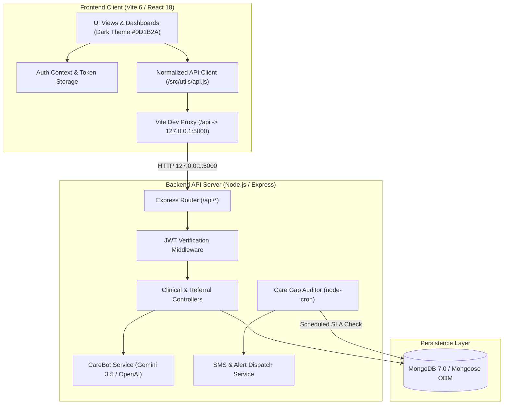

# ARCHITECTURE.md — CareLink System Architecture & Data Flow

## 1. High-Level Architecture Diagram



---

## 2. Network Routing & macOS AirPlay Mitigation

A critical architectural consideration on macOS environments:
1. **The Conflict:** macOS system daemon `ControlCenter` runs AirPlay Receiver on port 5000 bound to `0.0.0.0:5000` (`*:5000`). Browsers connecting to `http://localhost:5000` resolve to IPv6 (`::1:5000`), which AirPlay intercepts and responds with `HTTP 403 Forbidden` ("Direct IP access is not allowed").
2. **The Solution:** 
   - Express server explicitly binds to IPv4 loopback `127.0.0.1:5000`.
   - Frontend Vite dev server configures a reverse proxy:
     ```javascript
     proxy: {
       '/api': {
         target: 'http://127.0.0.1:5000',
         changeOrigin: true,
         secure: false,
       }
     }
     ```
   - Axios client in `src/utils/api.js` ensures all calls target `http://127.0.0.1:5000` and prefixes with `/api`.

---

## 3. Core Database Entities & Relationships

- **User**: Doctors, Admins, Pharmacists with hashed passwords (bcrypt) and facility linkage.
- **Hospital**: Facilities categorized by tier (`phc`, `chc`, `district`, `tertiary`) with ICU/oxygen bed metrics and diagnostic facilities.
- **Patient**: ABHA ID (Ayushman Bharat Health Account), demographic data, medical history, allergies, emergency contacts.
- **Referral**: Links Patient, Referring Hospital, Receiving Hospital, Urgency, Status (6 stages), Risk Score, Notes, and Transport.
- **DiagnosticResult**: Lab and radiology results with urgency level (`normal`, `abnormal`, `critical`) and reviewed status.
- **Medication**: Cross-facility prescriptions with active status and interaction markers.
- **Alert**: Care gap alerts generated by the cron auditor when referral SLAs are violated.
- **ChatMessage**: Conversational history with CareBot AI.
